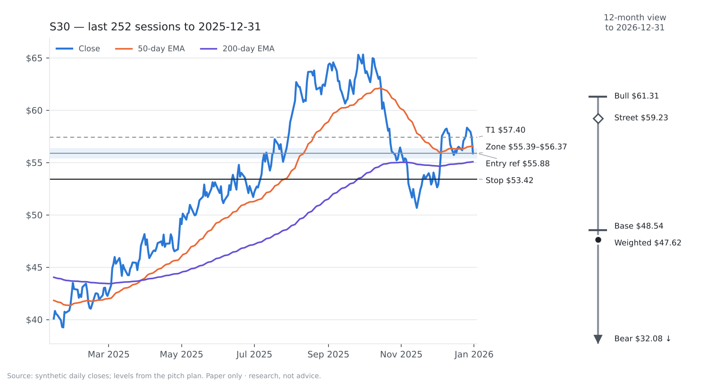
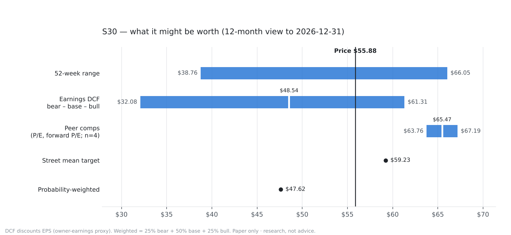
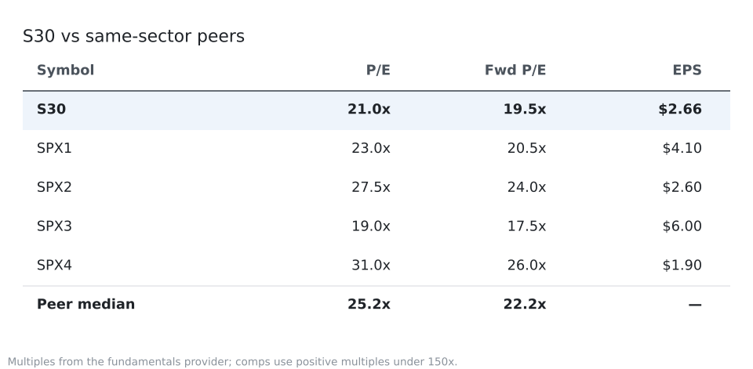

# BUY S30 — Synth Consumer Brands

> **Sample only.** Built by `abg` from a *synthetic* price panel (tickers S00–S59 are random walks) and stub fundamentals, so every company fact below is invented. It shows the format and the arithmetic, not a recommendation.

**Initiate position | Medium conviction (50) | 12-mo target $47.62 (-14.8%, total return -13.9%) | Trade T1 $57.40, stop $53.42, R:R 0.6 | Price $55.88 as of 2025-12-31**

*Mean reversion · ranked 1 of 2 that qualified today · signal from the close, to be acted on at the next open*

> **Views disagree.** The rule says BUY, while the 12-month probability-weighted target is -14.8% from here. Conviction is cut for it; treat this as a trade, sized as one.

**TL;DR**

- **Do:** Buy S30 at Friday's open near $55.88. A sharp sell-off in a long-term uptrend has it deeply oversold. Risk $2.46/share to a $57.40 first target in about 1 week(s).
- **Why now:** S30 is still in a long-term uptrend — the close of $55.88 is above its 200-day average of $55.68 — but it has just been sold hard: the 2-day RSI is 6.9, which is about as stretched as this measure gets. The book buys that weakness and sells into the first bounce, usually within a week.
- **Risk vs expect:** $327 at risk (0.37% of the fund) to the stop, for a first target +2.7% away (R:R 0.6).

## 01 Company Overview

| Market cap | Sector | Revenue (TTM) | P/E (NTM) | P/E (LTM) |
|---|---|---|---|---|
| $44.70 B | Consumer Staples | not in data | 19.5x | 21.0x |

**What they do**

Synth Consumer Brands sells packaged snacks and drinks through grocery and club stores. Most sales are in North America.

**Why now**

- S30 is still in a long-term uptrend — the close of $55.88 is above its 200-day average of $55.68 — but it has just been sold hard: the 2-day RSI is 6.9, which is about as stretched as this measure gets.
- The book buys that weakness and sells into the first bounce, usually within a week.
- Headline: Synth Consumer Brands reports quarterly results in line with guidance

**Competitive moat**

not in data

**Key financial metrics**

- EPS growth (TTM, YoY): +6.0%
- Gross margin: 42.0%
- Operating margin: 21.0%
- Net margin: 15.0%
- Dividend yield: 0.9%
- Beta: 1.05
- 52-week range: $38.76 – $66.05
- Revenue, free cash flow, net debt/EBITDA: not in data

## 02 Investment Thesis

### The thesis — core statement

Synth Consumer Brands: A sharp sell-off in a long-term uptrend has it deeply oversold. The mean reversion book is built to buy sharp short-term weakness in a stock still above its long-term average, and sell into the first bounce; this is that setup, not a forecast about the company.

The book is harvesting a documented behaviour: buy sharp short-term weakness in a stock still above its long-term average, and sell into the first bounce. That is the whole reason this trade exists — it is not a forecast about S30.

**Bull case**

Bull target $61.31 (+9.7%): earnings grow 11.5% a year.

**Bear case**

Bear value $32.08 (-42.6%); the trade's stop at $53.42 limits the loss well before that.

### Valuation cross-check and price targets

12-month view, horizon 2026-12-31. Each line shows its arithmetic:

- Bear: 10-year earnings DCF - $2.66 EPS growing 0.9% a year, fading to 2.5%, discounted at 10.4% = $32.08
- Base: 10-year earnings DCF - $2.66 EPS growing 7.7% a year, fading to 2.5%, discounted at 9.4% = $48.54
- Bull: 10-year earnings DCF - $2.66 EPS growing 11.5% a year, fading to 2.5%, discounted at 8.9% = $61.31
- Comps: 22.2x peer forward P/E x $2.87 forward EPS = $63.76; 25.2x peer P/E x $2.66 EPS = $67.19 (mean $65.47)
- Probability-weighted: 25% bear + 50% base + 25% bull = $47.62

| Case | Value | vs price |
|---|---|---|
| Bear | $32.08 | -42.6% |
| Base | $48.54 | -13.1% |
| Bull | $61.31 | +9.7% |

Dividend yield 0.9%; total return to the probability-weighted target -13.9%; street mean target $59.23 (+6.0%) — reference only; the price implies +11.2% a year of earnings growth against our +7.7%.

*Valuation is context. The rule above is what was tested and what decides the trade.*

### Current events and risks

- This is a short hold bought into weakness: the single biggest risk is that the weakness is news, not noise. A pullback that is actually the start of a re-rating keeps going, and the stop pays for it.
- 1 early-warning flag(s) are already on (vix_inversion) — stress score 0.11, crisis starts at 0.5.

Recent headlines:

- [Synth Consumer Brands reports quarterly results in line with guidance](https://example.com/sample)

## 03 Data & Supporting Analysis

**How this book has done** (replay, 2021-01-04 to 2025-12-31, 734 trades): win rate 52%, average win 0.39R, average loss -0.49R, expectancy -0.031R per trade, median hold 2 days. In-sample: the rules were not fitted on this window, but it is not a walk-forward record either.

## 04 Recommendation

### BUY — Initiate position · Medium conviction (50/100)

**Method:** Mean reversion — short swing, held a few days (at most 7 trading days).

### The trade plan

| | |
|---|---|
| Action | **BUY** at the open on Friday Jan 02, 2026 (tested entry) |
| Reference price | $55.88 (last close) |
| Entry zone | $55.39 – $56.37 (close ± 0.5 ATR) |
| Initial stop | $53.42 (-4.4%, 2.5× ATR of $0.98) |
| T1 | $57.40 (+2.7%) — rule exit: the book exits when the close gets back above the 5-day average, today $57.40 |
| 12-month targets | bear $32.08 · base $48.54 · bull $61.31 · weighted $47.62 (reference, by 2026-12-31) |
| Reward:risk | 0.62 — below the 1.5 minimum |
| Size | 133 shares, $7,432 = 8.5% of the fund (risk-based) |
| At risk | $327 = 0.37% of the fund |
| $10k account risking 1% | 17 shares |
| Max hold | 7 trading days |

*No stretch target: past winners' 75th-percentile exit ($57.19) is below the rule exit, so the rule exit is the target.*

**Conditional entries — untested refinements** (the scorecard tracks them apart from the tested entry):

- Don't chase: if it opens above $56.86 (close + 1 ATR), skip and re-check at the next close
- Gap below the stop: if it opens below the stop ($53.42), skip it

### What would make this wrong

We're wrong if:

- The long-term uptrend fails: a close below the 200-day average ($55.68)
- Held 7 days — the setup had its chance
- The catastrophe stop at $53.42 (2.5× ATR below the fill); there is no trailing stop here, the hold is too short for one
- The market turns risk-off, or crisis mode starts

### Why this fits our fund

It adds a diversifier (average 60-day correlation to holdings 0.17).

- Sector (Consumer Staples): 0.0% of the fund before, 8.5% after
- 60-day correlation: 0.17 to current holdings, 0.39 to the benchmark
- Beta: 0.71 (60-day vs SPY, from the bar store)
- Already held: no · AI-infrastructure name: no (the fund holds 0 today)

### Questions for the team

1. The rule says BUY, but the 12-month probability-weighted target is -15% from here. Do we size this as a trade only, or not at all?
2. The price implies 11.2% a year of earnings growth against our 7.7% estimate. What would have to go right for the market to be correct?

**Conviction 50** = 50 (start) +10 (all of the rule's checks passed) -3 (1 early-warning flag(s) on) -7 (trade view and 12-month view disagree)

## Market context

- Regime: **bull_chop** (a choppy but rising market), book size ×1
- Stress score 0.11, 1 early-warning flag(s) on
- This book currently has 21% of capital ($18,657), set by the Hedge allocator from how the books have been doing lately

## Every check the rule made

- [x] long-term uptrend: close above the 200-day average
- [x] oversold: RSI(2) below 10
- [x] this book trades in a bull chop market (size x1)

## Sources

- Prices: synthetic, daily bars to the 2025-12-31 close
- Fundamentals: stub (sample), as of 2025-12-31
- Base rates: replay, 2021-01-04 to 2025-12-31
- Rules: configs/stocks.yaml

## Glossary

- **ATR** — average true range: the stock's typical daily move in dollars over 14 days
- **R** — one unit of risk: entry minus stop. A +2R trade made twice what it risked
- **RSI** — relative strength index, 0-100: low means recently sold hard, high means bought hard
- **EMA / SMA** — exponential / simple moving average of the close
- **Momentum (12-1)** — the return over the last twelve months, skipping the most recent one
- **Regime** — the market's state from the benchmark's trend, volatility and choppiness
- **Reward:risk** — distance to the first target divided by distance to the stop

---

*Paper only. Nothing here places an order, and the desk holds no real position.*
*The single-stock universe is still the built-in seed list, which only contains names that survived to today. Load a real point-in-time index list before trusting any backtest number from it.*

*Research, not advice.*