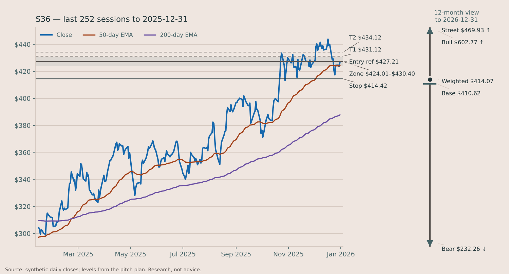
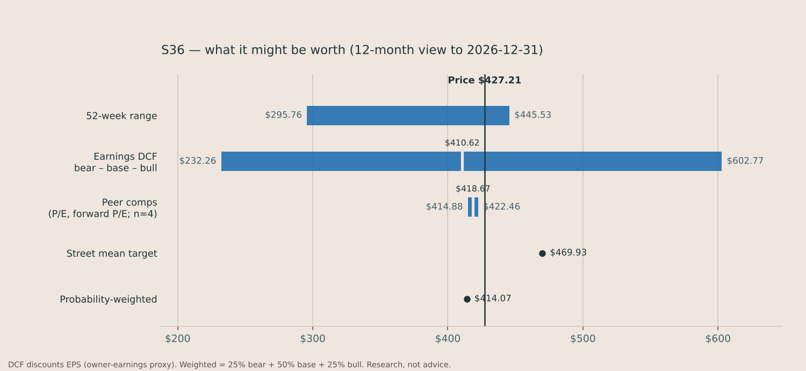
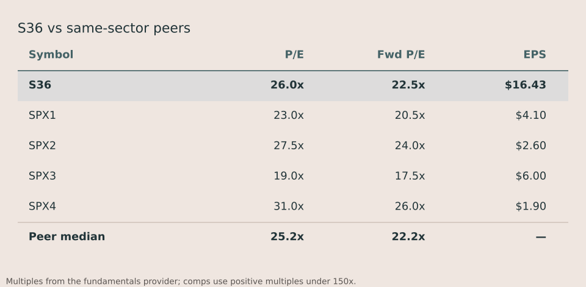

# BUY S36 — Synth Grid Systems

> **Sample only.** Built by `abg` from a *synthetic* price panel (tickers S00–S59 are random walks) and stub fundamentals, so every company fact below is invented. It shows the format and the arithmetic, not a recommendation.

**Initiate position | Low conviction (42) | 12-mo target $414.07 (-3.1%, total return -2.2%) | Trade T1 $431.12, stop $414.42, R:R 0.3 | Price $427.21 as of 2025-12-31**

*Trend pullback · ranked 1 of 2 that qualified today · signal from the close, to be acted on at the next open*

> **Views disagree.** The rule says BUY, while the 12-month probability-weighted target is -3.1% from here. Conviction is cut for it; treat this as a trade, sized as one.

**TL;DR**

- **Do:** Buy S36 at Friday's open near $427.21. A pullback in an established uptrend just ended. Risk $12.78/share to a $431.12 first target.
- **Why now:** S36 is in an established uptrend — the close of $427.21 is above its 200-day EMA of $387.79, and the 50-day EMA ($424.14) is above the 200-day. It then pulled back: RSI-14 got as low as 37.9 in the last five sessions. Today the pullback ended — the close is above yesterday's high of $424.35 and the MACD histogram turned up (-1.81 against -2.28 yesterday).
- **Risk vs expect:** 0.25% of the fund at risk to the stop, for a first target +0.9% away (R:R 0.3).

## 01 Company Overview

| Market cap | Sector | Revenue (TTM) | P/E (NTM) | P/E (LTM) |
|---|---|---|---|---|
| $341.77 B | Industrials | not in data | 22.5x | 26.0x |

**What they do**

Synth Grid Systems builds transformers and switchgear for utilities and data-center campuses. It earns most of its revenue on equipment and the rest on multi-year service contracts.

**Why now**

- S36 is in an established uptrend — the close of $427.21 is above its 200-day EMA of $387.79, and the 50-day EMA ($424.14) is above the 200-day.
- It then pulled back: RSI-14 got as low as 37.9 in the last five sessions.
- Today the pullback ended — the close is above yesterday's high of $424.35 and the MACD histogram turned up (-1.81 against -2.28 yesterday).
- Headline: Synth Grid Systems reports quarterly results in line with guidance

**Competitive moat**

not in data

**Key financial metrics**

- EPS growth (TTM, YoY): +14.0%
- Gross margin: 42.0%
- Operating margin: 21.0%
- Net margin: 15.0%
- Dividend yield: 0.9%
- Beta: 1.05
- 52-week range: $295.76 – $445.53
- Revenue, free cash flow, net debt/EBITDA: not in data

## 02 Investment Thesis

### The thesis — core statement

Synth Grid Systems: A pullback in an established uptrend just ended. The trend pullback book is built to buy a short pullback inside an established uptrend, as the pullback ends; this is that setup, not a forecast about the company.

The book is harvesting a documented behaviour: buy a short pullback inside an established uptrend, as the pullback ends. That is the whole reason this trade exists — it is not a forecast about S36.

**Bull case**

Bull target $602.77 (+41.1%): earnings grow 23.3% a year.

**Bear case**

Bear value $232.26 (-45.6%); the trade's stop at $414.42 limits the loss well before that.

### Valuation cross-check and price targets

12-month view, horizon 2026-12-31. Each line shows its arithmetic:

- Bear: 10-year earnings DCF - $16.43 EPS growing 4.8% a year, fading to 2.5%, discounted at 10.4% = $232.26
- Base: 10-year earnings DCF - $16.43 EPS growing 15.6% a year, fading to 2.5%, discounted at 9.4% = $410.62
- Bull: 10-year earnings DCF - $16.43 EPS growing 23.3% a year, fading to 2.5%, discounted at 8.9% = $602.77
- Comps: 22.2x peer forward P/E x $18.99 forward EPS = $422.46; 25.2x peer P/E x $16.43 EPS = $414.88 (mean $418.67)
- Probability-weighted: 25% bear + 50% base + 25% bull = $414.07

| Case | Value | vs price |
|---|---|---|
| Bear | $232.26 | -45.6% |
| Base | $410.62 | -3.9% |
| Bull | $602.77 | +41.1% |

Dividend yield 0.9%; total return to the probability-weighted target -2.2%; street mean target $469.93 (+10.0%) — reference only; the price implies +16.6% a year of earnings growth against our +15.6%.

*Valuation is context. The rule above is what was tested and what decides the trade.*

### Current events and risks

- This is a short hold bought into weakness: the single biggest risk is that the weakness is news, not noise. A pullback that is actually the start of a re-rating keeps going, and the stop pays for it.
- 1 early-warning flag(s) are already on (vix_inversion) — stress score 0.11, crisis starts at 0.5.
- Valuation disagrees with the rule: the blended fair value is -2.9% against the current price. The rule is what was tested, so the trade stands, but this is a reason to keep it small.

Recent headlines:

- [Synth Grid Systems reports quarterly results in line with guidance](https://example.com/sample)

## 03 Data & Supporting Analysis

**How this book has done** (replay, 2021-01-04 to 2025-12-31, 510 trades): win rate 43%, average win 0.49R, average loss -0.47R, expectancy -0.059R per trade, median hold under a day. In-sample: the rules were not fitted on this window, but it is not a walk-forward record either.

## 04 Recommendation

### BUY — Initiate position · Low conviction (42/100)

**Method:** Trend pullback — swing trade, held days to a few weeks (at most 30 trading days).

### The trade plan

| | |
|---|---|
| Action | **BUY** at the open on Friday Jan 02, 2026 (tested entry) |
| Reference price | $427.21 (last close) |
| Entry zone | $424.01 – $430.40 (close ± 0.5 ATR) |
| Initial stop | $414.42 (-3.0%, 2.0× ATR of $6.39) |
| T1 | $431.12 (+0.9%) — reference level: median winning exit of this book's replayed trades = 0.31R; 0.31 x $12.78 risk + $427.21 entry |
| T2 | $434.12 (+1.6%) — reference level: 75th-percentile winning exit of this book's replayed trades = 0.54R; 0.54 x $12.78 risk + $427.21 entry |
| 12-month targets | bear $232.26 · base $410.62 · bull $602.77 · weighted $414.07 (reference, by 2026-12-31) |
| Reward:risk | 0.31 — below the 1.5 minimum |
| Suggested size | 8.4% of the fund (risk-based) |
| At risk | 0.25% of the fund |
| $10k account risking 1% | 2 shares |
| Max hold | 30 trading days |

*The book has no fixed profit target: it exits on RSI-14 > 70, a close below the 50-day EMA, the trailing stop or time. T1/T2 are where its past winners exited.*

**Conditional entries — untested refinements** (the scorecard tracks them apart from the tested entry):

- Don't chase: if it opens above $433.60 (close + 1 ATR), skip and re-check at the next close
- Gap below the stop: if it opens below the stop ($414.42), skip it

### What would make this wrong

We're wrong if:

- The trend breaks: a close below the 50-day EMA ($424.14)
- Held 30 days without resolving
- The initial stop at $414.42 is touched (2.0× ATR below the fill)
- A trailing stop 3.0× ATR under the highest close since entry, which only ever ratchets up
- The market turns risk-off, or crisis mode starts
- The daily news score drops below -0.7

### Why this fits our fund

- Sector: Industrials
- 60-day correlation: 0.41 to the benchmark
- Beta: 0.61 (60-day vs SPY, from the bar store)
- Fund holdings: holdings not provided (add them in Settings) · AI-infrastructure name: no

### Questions for the team

1. The rule says BUY, but the 12-month probability-weighted target is -3% from here. Do we size this as a trade only, or not at all?
2. The stock is 4% below its 52-week high of $445.53. Is that room to run, or overhead supply?

**Conviction 42** = 50 (start) +10 (all of the rule's checks passed) -8 (valuation disagrees (-3%)) -3 (1 early-warning flag(s) on) -7 (trade view and 12-month view disagree)

## Market context

- Regime: **bull_chop** (a choppy but rising market), book size ×0.5
- Stress score 0.11, 1 early-warning flag(s) on
- This book currently has 22% of capital (—), set by the Hedge allocator from how the books have been doing lately

## Every check the rule made

- [x] uptrend: close above the 200-day EMA
- [x] uptrend: 50-day EMA above the 200-day
- [x] a pullback happened: lowest RSI-14 of the last 5 days at or below 40
- [x] the pullback is ending: close above yesterday's high
- [x] the pullback is ending: MACD histogram rising
- [x] this book trades in a bull chop market (size x0.5)

## Sources

- Prices: synthetic, daily bars to the 2025-12-31 close
- Fundamentals: stub (sample), as of 2025-12-31
- Base rates: replay, 2021-01-04 to 2025-12-31
- Rules: configs/stocks.yaml

## Glossary

- **ATR** — average true range: the stock's typical daily move in dollars over 14 days
- **R** — one unit of risk: entry minus stop. A +2R trade made twice what it risked
- **RSI** — relative strength index, 0-100: low means recently sold hard, high means bought hard
- **EMA / SMA** — exponential / simple moving average of the close
- **Momentum (12-1)** — the return over the last twelve months, skipping the most recent one
- **Regime** — the market's state from the benchmark's trend, volatility and choppiness
- **Reward:risk** — distance to the first target divided by distance to the stop

---

*Research only. The desk pitches ideas; nothing here places an order.*
*The single-stock universe is still the built-in seed list, which only contains names that survived to today. Load a real point-in-time index list before trusting any backtest number from it.*

*Research, not advice.*