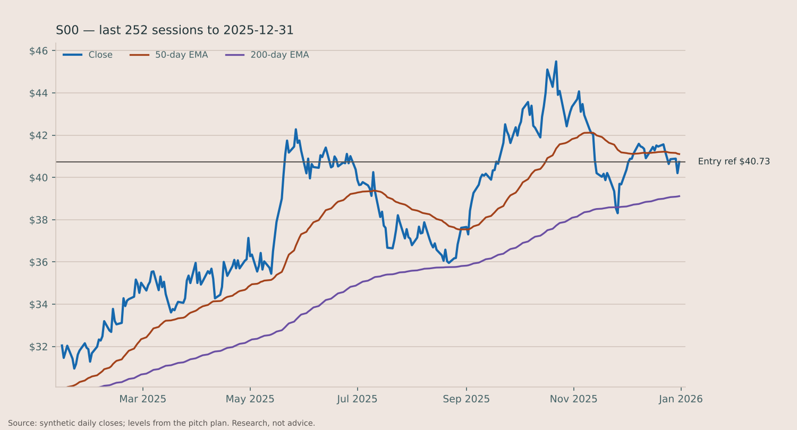

# SELL S00

> **Sample only.** Built by `abg` from a *synthetic* price panel (tickers S00–S59 are random walks) and stub fundamentals, so every company fact below is invented. It shows the format and the arithmetic, not a recommendation.

**Close position | rule exit | Price $40.73 as of 2025-12-31**

*Mean reversion · signal from the close, to be acted on at the next open*

**TL;DR**

- **Do:** Sell S00 at Friday's open: sma5 exit.
- **Why now:** The mean reversion book's exit fired on S00: sma5 exit, at the close of $40.73. The rule closes the position at the next open; this is the trade ending on its own terms, not a new view on the company.

## 01 Company Overview

| Market cap | Sector | Revenue (TTM) | P/E (NTM) | P/E (LTM) |
|---|---|---|---|---|
| not in data | not in data | not in data | not in data | not in data |

**What they do**

not in data

**Why now**

- The mean reversion book's exit fired on S00: sma5 exit, at the close of $40.73.
- The rule closes the position at the next open; this is the trade ending on its own terms, not a new view on the company.

**Competitive moat**

not in data

**Key financial metrics**

- not in data
- Revenue, free cash flow, net debt/EBITDA: not in data

## 02 Investment Thesis

### The thesis — core statement

S00: The mean reversion book's exit fired (sma5 exit). The book is built to buy sharp short-term weakness in a stock still above its long-term average, and sell into the first bounce; the trade it opened is over by its own rules. This is the exit, not a view on the company.

The book is harvesting a documented behaviour: buy sharp short-term weakness in a stock still above its long-term average, and sell into the first bounce. That is the whole reason this trade exists — it is not a forecast about S00.

**Bull case**

not in data

**Bear case**

not in data

### Valuation / price target

12-month targets: not in data (no fundamentals for this name).

### Current events and risks

- This is a short hold bought into weakness: the single biggest risk is that the weakness is news, not noise. A pullback that is actually the start of a re-rating keeps going, and the stop pays for it.
- 1 early-warning flag(s) are already on (vix_inversion) — stress score 0.11, crisis starts at 0.5.
- No fundamentals were available for this name, so there is no valuation cross-check — the pitch rests on price behaviour alone.

## 03 Data & Supporting Analysis

**How this book has done** (replay, 2021-01-04 to 2025-12-31, 734 trades): win rate 52%, average win 0.39R, average loss -0.49R, expectancy -0.031R per trade, median hold 2 days. In-sample: the rules were not fitted on this window, but it is not a walk-forward record either.

## 04 Recommendation

### SELL — Close position · rule exit

**Method:** Mean reversion — short swing, held a few days (at most 7 trading days).

### The trade plan

| | |
|---|---|
| Action | **SELL** at the open on Friday Jan 02, 2026 (tested exit) |
| Reference price | $40.73 (last close) |
| Max hold | 7 trading days |

### Why we're exiting

The rule's exit fired: sma5 exit.

- Result: not in data (we have no open pitch on this name; the exit is the rule's, from its historical replay)

### What would make this wrong

We're wrong if:

- It keeps going without us: a close above $41.34 (today + 1 ATR) within a week would say the exit was early
- The exit is the rule's, and the rule is what was tested: second-guessing it is an untested change

### Why this fits our fund

An exit frees the capital; fit is a question for the next entry, not this one.

### Questions for the team

1. This book's replayed expectancy is -0.031R per trade over 734 trades. Is that still worth the capital it takes?
2. If the same setup fires again on this name, does the team want it, or should it be excluded?

## Market context

- Regime: **bull_chop** (a choppy but rising market), book size ×1
- Stress score 0.11, 1 early-warning flag(s) on
- This book currently has 21% of capital (—), set by the Hedge allocator from how the books have been doing lately

## Every check the rule made

- [x] long-term uptrend: close above the 200-day average
- [ ] oversold: RSI(2) below 10
- [x] this book trades in a bull chop market (size x1)

## Sources

- Prices: synthetic, daily bars to the 2025-12-31 close
- Fundamentals: stub (sample), as of 2025-12-31
- Base rates: replay, 2021-01-04 to 2025-12-31
- Rules: configs/stocks.yaml

## Glossary

- **ATR** — average true range: the stock's typical daily move in dollars over 14 days
- **R** — one unit of risk: entry minus stop. A +2R trade made twice what it risked
- **RSI** — relative strength index, 0-100: low means recently sold hard, high means bought hard
- **EMA / SMA** — exponential / simple moving average of the close
- **Momentum (12-1)** — the return over the last twelve months, skipping the most recent one
- **Regime** — the market's state from the benchmark's trend, volatility and choppiness
- **Reward:risk** — distance to the first target divided by distance to the stop

---

*Research only. The desk pitches ideas; nothing here places an order.*
*The single-stock universe is still the built-in seed list, which only contains names that survived to today. Load a real point-in-time index list before trusting any backtest number from it.*

*Research, not advice.*